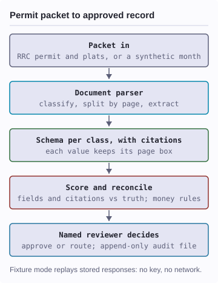
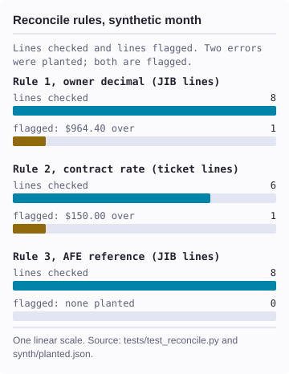

# jib-ai-wingmate

A well-file demo kit: drilling-permit packets in, cited fields out, a named person approves each exception.


[](demo/typed/typed_questions.py#L539)
[](demo/build_corpus.py#L287)
[](demo/audit/pack.py#L168)
[](demo/typed/jev_backend.py#L252)
[](demo/mcp/.mcp.json#L1)
[](demo/score.py#L87)
[](demo/score.py#L294)
[](demo/typed/jev_backend.py#L54)
[](demo/reviewer/serve.py#L27)
[](demo/reviewer/serve.py#L115)
[](demo/reconcile.py#L127)
[](demo/heldout2/tests/test_controls.py#L2)

<p align="center"><picture><source media="(prefers-color-scheme: dark)" srcset="docs/diagrams/pipeline-dark.svg"/></picture> <picture><source media="(prefers-color-scheme: dark)" srcset="docs/diagrams/reconcile-dark.svg"/></picture></p>

<details><summary>Text version of the pipeline diagram</summary>

A permit packet comes in. It is a Texas Railroad Commission (RRC)
drilling permit (form W-1) with its plats, or a synthetic oil and gas
month. A document parser classifies each document, splits the packet by
page, and extracts a schema for each document class. Every value keeps a
citation: its page and its box on the page. The scorer grades fields and
citations against truth files. Reconcile rules check the money. A named
reviewer approves or routes each exception, and each decision appends to
an audit file. Fixture mode replays stored responses: no key, no network.

</details>

<details><summary>Text version of the reconcile chart</summary>

Reconcile rules on the synthetic Caprock month, from the committed test.
Rule 1, owner decimal: 8 JIB (joint interest billing) lines checked,
1 flagged, $964.40 overbilled. Rule 2, contract rate: 6 field-ticket lines
checked, 1 flagged, $150.00 overbilled. Rule 3, AFE (authority for
expenditure) reference: 8 JIB lines checked, 0 flagged; none was planted.

</details>

This repo holds the code, schemas, truth files, fixtures, and synthetic
corpora of a beta demo kit. It is not a benchmark of any product. No live
result is committed: every number on this page is synthetic data or
fixture output, and each one traces to a committed file or a test.

**Based on:** public RRC drilling-permit records (see [NOTICE](NOTICE)),
plus synthetic documents built in this repo.

## Status

- **Beta.** The code is copied as run, with the publication edits listed
  under Known limitations; this page and the hygiene files are new.
- **Scorer selftest:** 13 values computed by hand, reproduced exactly. [Receipt](demo/tests/selftest/README.md).
- **Synthetic month:** 2 planted money errors, both flagged by the rules. [Receipt](demo/synth/planted.json).
- **CI:** offline tests and a secret scan. Passed on main, 2026-10-22. [Runs](https://github.com/frankbesch/jib-ai-wingmate/actions/workflows/ci.yml).

## Measured results

All figures come from offline runs on 2026-10-22, on synthetic or fixture
data. None is a live parser result.

- **Scorer selftest:** 13 of 13 expected values reproduced. Example:
  all-field accuracy 0.9412, citation precision at IoU 0.5 of 0.8.
- **Synthetic pipeline test:** 10 of 10 checks pass in fixture mode.
- **Reconcile test:** 11 of 11 checks pass; rule 1 and rule 2 each fire
  on exactly one line, rule 3 on none.
- **Held-out orchestrator:** 124 unittest tests, OK, 1 skipped.

IoU (intersection over union) measures how well a cited box overlaps the
true box on the page.

## How it works

Joint Interest Billing (JIB) is the core process inside Joint Venture
Accounting, usually run end to end as AFE-to-JIB. The operator spends
money on a well and bills each working-interest partner for its share
under the Joint Operating Agreement.

The pipeline runs in one of two modes. Live mode calls a document
parser's API for classify, split, and schema extraction. Fixture mode
replays stored responses that `make_fixtures.py` derives from the truth
files, with labelled perturbations so a fixture is never read as a
measurement.

<details><summary>Components</summary>

All code and data live in `demo/`; paths in this README are relative to it.

| Component | Where |
|---|---|
| Corpus builder (from local RRC files) | `build_corpus.py` |
| Pipeline, live and fixture modes | `pipeline.py` |
| Synthetic responses with labelled errors | `make_fixtures.py` |
| Scorer and hand-computed selftest | `score.py`, `tests/selftest/` |
| Synthetic-month scorer | `score_synth.py` |
| Reconcile rules | `reconcile.py` |
| Reviewer UI and approvals | `reviewer/` |
| Audit pack | `audit/pack.py` |
| Analyst: MCP config, offline fallback | `mcp/` |
| Demo console builder | `console/build_console.py` |
| Synthetic Caprock month (fictional) | `synth/` |
| Held-out synthetic sets | `synth-pilot/`, `synth-heldout/` |
| Held-out orchestrator | `heldout2/` |
| Typed-question replays | `typed/` |
| Truth files | `truth/` |

</details>

## Quick start

- Python 3.12 or later.
- From the repo root: `pip install -r requirements.txt` (Pillow, pypdf).
- No key and no network for any step below.

```bash
cd demo
# 1. Scorer selftest.
python3 score.py --selftest
# expect: SELFTEST PASS

# 2. Synthetic month, fixture mode.
python3 make_fixtures.py --set synth \
  && python3 pipeline.py \
     --mode fixture --set synth \
     --run-id fixture-synth-01 \
  && python3 \
     tests/test_synth_pipeline.py
# expect: 10/10 passed

# 3. Reconcile rules.
python3 tests/test_reconcile.py
# expect: 11/11 passed
```

Step 2 writes `demo/runs/fixture-synth-01/`; `runs/` is gitignored.

## Measured run

The held-out orchestrator drives a staged run with freezes, a ledger,
deadlines, and a scrubbed child environment. Its tests use stub stages
and committed fixtures, so they need no key. On this machine they took
about 460 seconds.

```bash
# from demo/
python3 -m unittest discover \
  -s heldout2/tests -p 'test_*.py'
# expect: Ran 124 tests
#   OK (skips vary by platform)
```

## Known limitations

- **No live result is committed.** Every number on this page is synthetic
  data or fixture output.
- **Live mode needs a parser API key and base URL** (`PULSE_API_KEY`,
  `PULSE_BASE_URL`; see [.env.example](.env.example)). It spends credits.
- **Some tests need gitignored live runs.** `tests/test_split_schema.py`
  fails without `runs/live-clean-02/`. `tests/test_typed_questions.py` and
  `tests/test_jev_backend.py` print SKIP without `runs/live-synth-03/`.
- **RRC raw files are not shipped.** The permit PDFs and the permit master
  `.dat` file stay out; `build_corpus.py` rebuilds the corpus from local
  copies, and its source URLs (`mft.rrc.texas.gov`, `www.rrc.texas.gov`)
  are at lines 31-33.
- **The orchestrator launcher tests are macOS-only.**
  `heldout2/tests/test_orchestrator.py` needs `sandbox-exec`,
  `DARWIN_USER_TEMP_DIR`, and a checkout under `~/Documents`. CI runs the
  other three held-out test files (62 tests).
- **Publication edits.** The parser vendor's name is generalized in docs
  and UI text; console presenter notes are removed; key-loader lines now
  point to `export` and `.env.example`; `PULSE_BASE_URL` is required in
  live mode; the audit-pack renderer is read from `AUDIT_RENDER_SH`;
  private path notes are rewritten. No scorer, reconcile, fixture, or
  test logic changed.
- **Some docs point to unpublished notes** under `artifacts/` and
  `reviews/`; those links lead nowhere.
- **`synth-pilot/REPORT.md` has a stale header.** It still reads as blocked.
- **MCP URL expansion is unverified.** Whether a client expands
  `${PARSER_MCP_URL}` in `mcp/.mcp.json` was not tested.
- **One request shape.** The client targets one parser API's request and
  response shape; another parser needs a new client.

## More

- [Scorer selftest](demo/tests/selftest/README.md): each expected value, worked by hand.
- [Synthetic month truth](demo/truth/synth/README.md): how the Caprock keys were made.
- [Held-out synthetic corpus](demo/synth-heldout/README.md): documents, packets, seeds.
- [Analyst setup](demo/mcp/README.md): MCP config and the offline fallback.
- [Security policy](.github/SECURITY.md) and [environment variables](.env.example).

## License

Code: MIT. See [LICENSE](LICENSE). Files derived from Texas Railroad
Commission public records stay under RRC terms and are excluded from the
MIT license. See [NOTICE](NOTICE) for the exact paths.

**Last measured**: 2026-10-22. Offline runs only; see Measured results.
